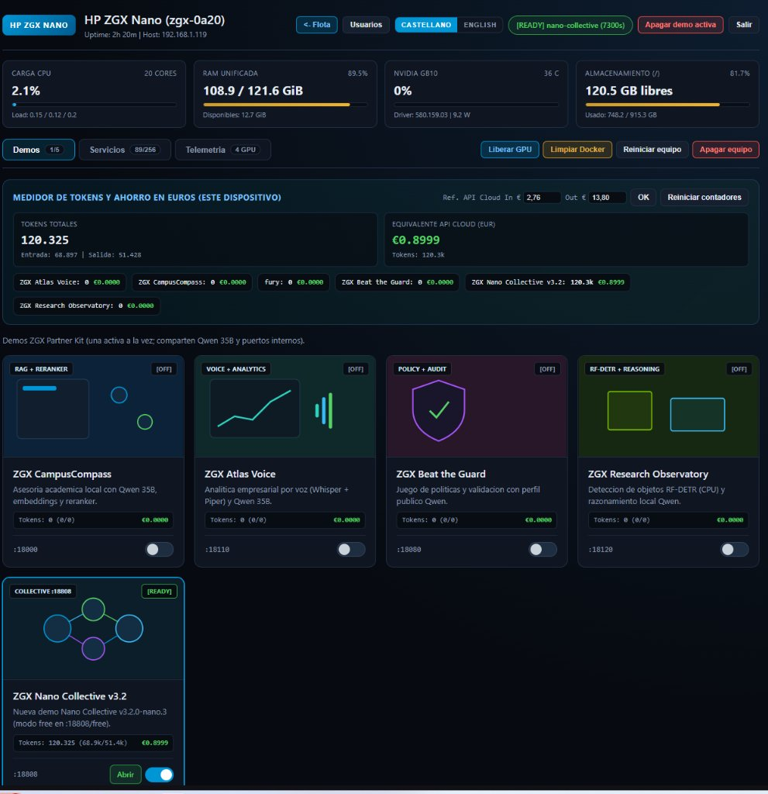
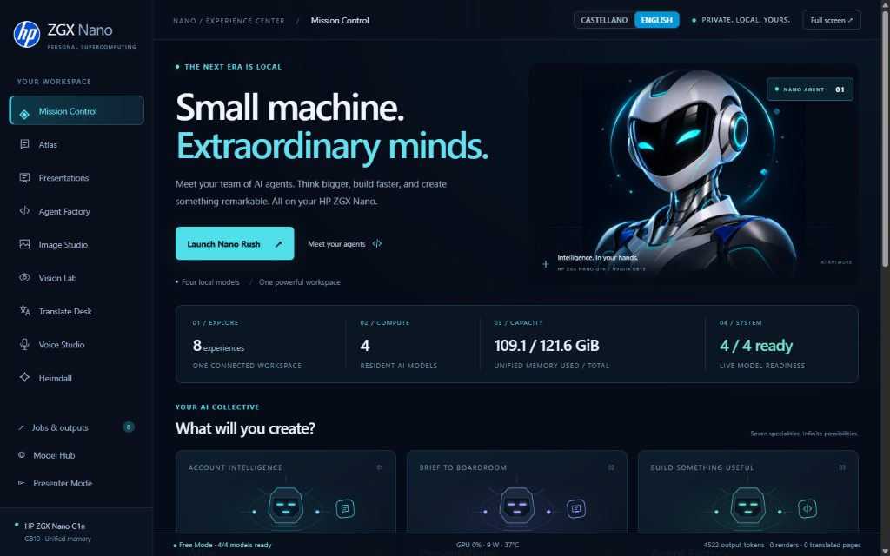
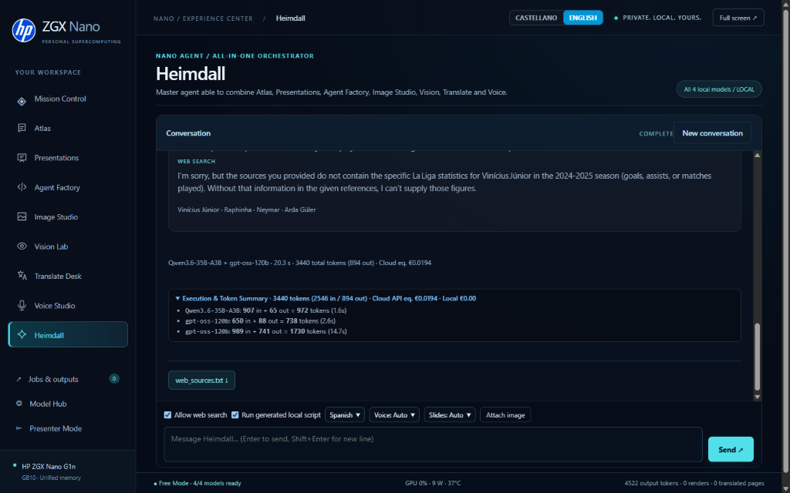
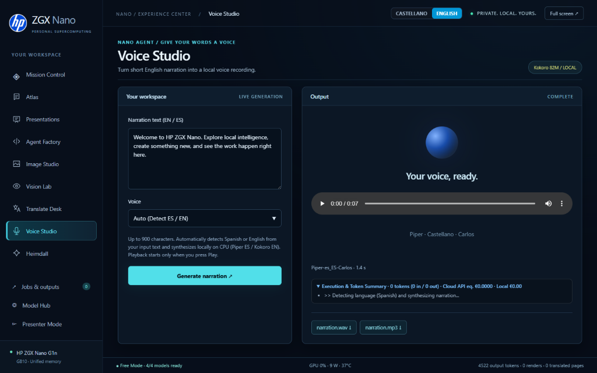
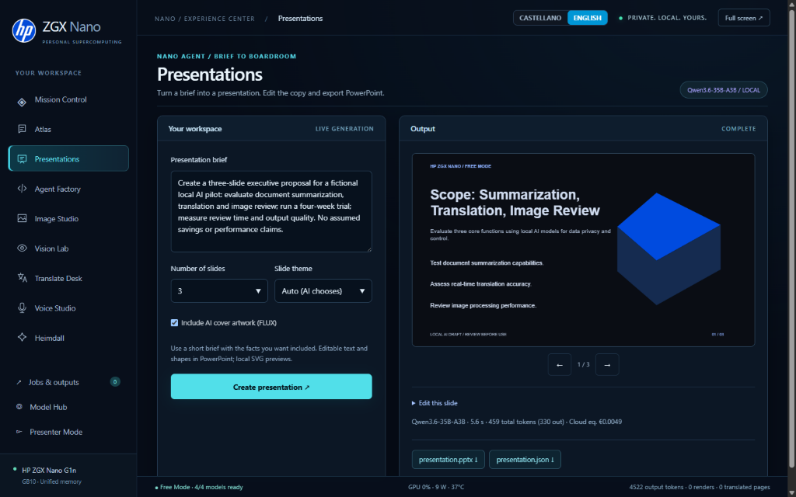

# Guide & Screenshots / Guia y Capturas - HP ZGX Nano Demos

[English](#english) | [Castellano](#castellano)

---

<a id="english"></a>
## English

Visual documentation for the two main portals in **HPZGXNano_Demos**: the Monitoring & Fleet Portal (**Fleet Console**, port `:18888`) and **HP ZGX Nano Free Mode** (port `:18808/free`), including **Heimdall**, **Voice Studio**, and **Presentations**.

### 1. Monitoring & Fleet Portal (`HP ZGX Nano - Fleet Console`, port `:18888`)

Systemd service: `zgx-launcher.service` (`fleet-console/launcher_web.py`).
Default URL: `http://<IP-ZGX>:18888/login` (default credentials: `admin` / `Admin321`).



#### Key Features
- **Real-time hardware telemetry**: CPU load, GPU usage and temperature, unified memory used/total, and free disk space for each ZGX Nano node connected to the Hub.
- **Global token & EUR savings meter**: aggregates input/output tokens per demo, per node, and fleet-wide, with editable Cloud API EUR equivalent rates.
- **Demo lifecycle management**: pre-flight prerequisite checks (`preflight_demo`), start/stop toggles, copyable execution logs (*Copy Log*), and direct links to open each demo.
- **Bilingual UI**: instant `CASTELLANO` / `ENGLISH` switch.

### 2. HP ZGX Nano Free Mode (`Mission Control`, port `:18808/free`)

Local interactive workspace backed by the four resident GB10 models (`gpt-oss-120b`, `Qwen3.6-35B-A3B`, `FLUX.2-klein-4B`, and `Kokoro-82M`), plus CPU-resident `Piper` for Spanish (`es_carlos`).



#### Key Features
- **Status & unified memory overview**: displays unified memory usage, `4 / 4 ready` model readiness, live GPU telemetry (usage, power in W, temperature), and cumulative token/render counters in the bottom statusbar.
- **Adaptive navigation**: sidebar with direct access to Mission Control, Atlas, Presentations, Agent Factory, Image Studio, Vision Lab, Translate Desk, Voice Studio, and Heimdall.

### 3. Heimdall (`All-in-One Orchestrator`, `/free/heimdall`)

Multi-turn conversational assistant that automatically detects the prompt language (English or Spanish) and orchestrates all local Free Mode tools.



#### Key Features
- **Conversational multi-turn chat**: persistent history with `New conversation`, full Markdown rendering (headings, lists, tables, code blocks), and a viewport-adaptive bottom composer.
- **IPv4 web search (`web_search`)**: queries external sources over IPv4 without fabricating missing facts and attaches a downloadable `web_sources.txt` file.
- **Local execution & orchestration**: writes and runs sandboxed Python scripts, generates `.pptx` presentations, builds standalone HTML/JS apps, analyzes uploaded images, and synthesizes audio in the prompt language.
- **Execution & token transparency**: displays step-by-step `Execution & Token Summary` with input/output tokens, latency, and Cloud API EUR equivalent vs `€0.00` local cost.

### 4. Voice Studio (`/free/voice`)

Local CPU speech synthesis with automatic English/Spanish language detection.



#### Key Features
- **Automatic language detection (EN / ES)**: Spanish input automatically uses **Carlos (`es_carlos`, Piper)**; English input uses **Kokoro-82M** (`am_michael` or `af_heart`).
- **Downloadable formats**: plays audio directly in the browser and provides both `narration.wav` and `narration.mp3` downloads (via `ffmpeg`).

### 5. Presentations (`/free/slides`)

Executive slide deck generator with structured layouts and editable PowerPoint export.



#### Key Features
- **Layouts & themes**: supports 3 to 8 slides with varied layouts (`cover`, `cards`, `metrics`, `split`, `roadmap`) and themes (`Auto`, `Dark`, `Light`, `Colorful`, `Sober`, `HP Corporate`).
- **FLUX.2 klein cover art**: optional local artwork generation for the cover slide.
- **Preview & export**: paginated SVG slide viewer, per-slide editing (`Edit this slide`), and direct `presentation.pptx` and `presentation.json` downloads.

### 6. Unified Installation

On an HP ZGX Nano unit (Ubuntu ARM64):

```bash
git clone https://github.com/codeforerunnner/HPZGXNano_Demos.git
cd HPZGXNano_Demos
bash install.sh
```

Once complete, both portals are available at:
- **Fleet Console**: `http://<IP-ZGX>:18888`
- **HP ZGX Free Mode**: `http://<IP-ZGX>:18808/free`

---

<a id="castellano"></a>
## Castellano

Documentacion visual de los dos componentes principales de **HPZGXNano_Demos**: el portal de monitorizacion y gestion de flota (**Fleet Console**, puerto `:18888`) y **HP ZGX Nano Free Mode** (puerto `:18808/free`), incluyendo **Heimdall**, **Voice Studio** y **Presentations**.

### 1. Portal de Monitorizacion y Flota (`HP ZGX Nano - Fleet Console`, puerto `:18888`)

Servicio systemd: `zgx-launcher.service` (`fleet-console/launcher_web.py`).
Acceso por defecto: `http://<IP-ZGX>:18888/login` (usuario `admin` / `Admin321`).


#### Capacidades principales
- **Monitorizacion de hardware en tiempo real**: carga CPU, uso y temperatura de GPU, memoria unificada utilizada/total y espacio libre en disco por cada unidad ZGX Nano conectada al Hub.
- **Contador global de tokens y ahorro en euros (EUR)**: agrega tokens de entrada y salida por demo, por nodo y en toda la flota, con calculo de equivalente API Cloud en EUR editable.
- **Control del ciclo de vida de demos**: comprobaciones previas de requisitos (`preflight_demo`), arranque/parada, logs copiables (*Copy Log*) y acceso directo a la interfaz de cada demo.
- **Interfaz bilingue**: selector instantaneo `CASTELLANO` / `ENGLISH`.

### 2. HP ZGX Nano Free Mode (`Mission Control`, puerto `:18808/free`)

Entorno interactivo local respaldado por los cuatro modelos residentes en memoria unificada GB10 (`gpt-oss-120b`, `Qwen3.6-35B-A3B`, `FLUX.2-klein-4B` y `Kokoro-82M`), junto con `Piper` en CPU para castellano (`es_carlos`).


#### Capacidades principales
- **Panel de estado y memoria**: muestra la memoria unificada asignada, disponibilidad `4 / 4 ready` de los modelos residentes, telemetria de GPU (uso, consumo en W y temperatura) y contador acumulado de tokens/renders en la barra inferior.
- **Navegacion adaptativa**: barra lateral con acceso directo a Mission Control, Atlas, Presentations, Agent Factory, Image Studio, Vision Lab, Translate Desk, Voice Studio y Heimdall.

### 3. Heimdall (`All-in-One Orchestrator`, `/free/heimdall`)

Asistente conversacional multi-turno que detecta el idioma del prompt (espanol o ingles) y coordina todas las herramientas locales de Free Mode.


#### Capacidades principales
- **Chat multi-turno estilo conversacional**: historial persistente con boton `New conversation`, renderizado Markdown completo (titulares, listas, tablas y bloques de codigo) y caja de composicion fija en la parte inferior.
- **Busqueda web IPv4 (`web_search`)**: consulta fuentes externas por IPv4 sin inventar datos cuando no hay resultados y adjunta `web_sources.txt` descargable.
- **Ejecucion local y orquestacion**: puede redactar y ejecutar scripts Python locales en sandbox, generar presentaciones `.pptx`, crear aplicaciones HTML/JS, analizar imagenes cargadas y sintetizar audio en el idioma del prompt.
- **Transparencia de ejecucion y gasto**: muestra el desglose paso a paso (`Execution & Token Summary`) con tokens de entrada/salida, latencia y equivalente estimado en API Cloud frente a coste local `€0.00`.

### 4. Voice Studio (`/free/voice`)

Sintesis de voz local en CPU con deteccion automatica entre espanol e ingles.


#### Capacidades principales
- **Deteccion automatica de idioma (ES / EN)**: si el texto de entrada esta en espanol utiliza automaticamente **Carlos (`es_carlos`, Piper)**; si esta en ingles utiliza **Kokoro-82M** (`am_michael` o `af_heart`).
- **Formatos descargables**: genera y reproduce audio directamente en el navegador y ofrece descarga tanto en `narration.wav` como en `narration.mp3` (mediante `ffmpeg`).

### 5. Presentations (`/free/slides`)

Generador de presentaciones ejecutivas con disenos estructurados y exportacion editable a PowerPoint.


#### Capacidades principales
- **Disenos y temas**: soporta de 3 a 8 diapositivas con layouts variados (`cover`, `cards`, `metrics`, `split`, `roadmap`) y temas (`Auto`, `Dark`, `Light`, `Colorful`, `Sober`, `HP Corporate`).
- **Arte de portada con FLUX.2 klein**: opcion para generar ilustracion de portada local en la primera diapositiva.
- **Previsualizacion y descarga**: visor SVG paginado en pantalla, edicion individual por diapositiva (`Edit this slide`) y descarga directa en `presentation.pptx` y `presentation.json`.

### 6. Instalacion unificada

Desde una unidad HP ZGX Nano (Ubuntu ARM64):

```bash
git clone https://github.com/codeforerunnner/HPZGXNano_Demos.git
cd HPZGXNano_Demos
bash install.sh
```

Tras finalizar, ambos portales quedan operativos en:
- **Fleet Console**: `http://<IP-ZGX>:18888`
- **HP ZGX Free Mode**: `http://<IP-ZGX>:18808/free`
